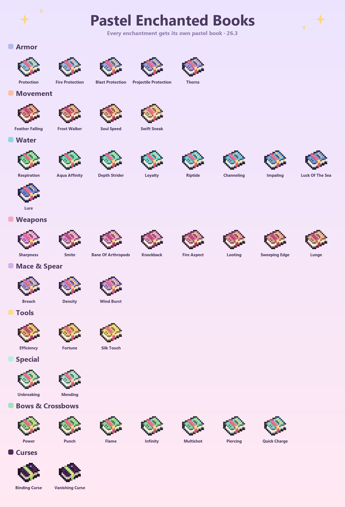
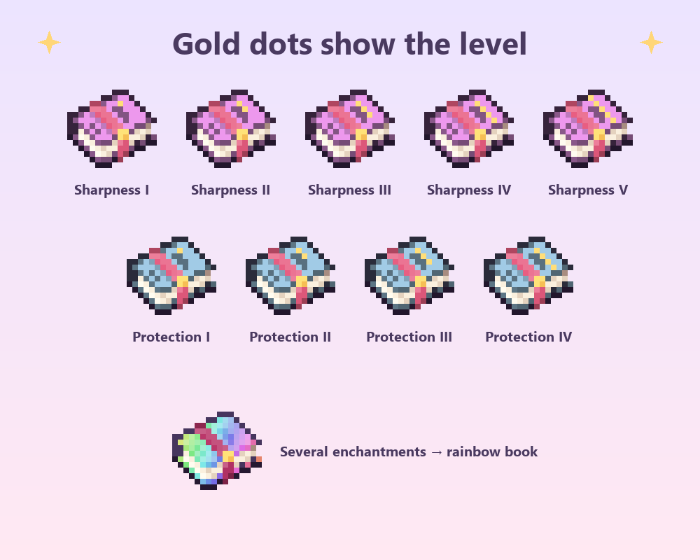

<p align="center"></p>

# Pastel Enchanted Books

Un paquete de texturas para Minecraft 26.3 que le da a cada libro encantado su propio color pastel, según el encantamiento y el nivel. Los libros mantienen la forma original, su cinta, su broche dorado y su brillo encantado.



## Qué hace
- **43 encantamientos, 128 texturas**: un tono distinto para cada uno.
- **Familias de colores**: azul para armadura, rosa para armas, amarillo para herramientas, verde para arcos y ballestas, aguamarina para agua, durazno para movimiento, lila para la maza y menta para los especiales.
- **Puntitos dorados en la tapa** que muestran el nivel.
- **Maldiciones** en morado oscuro con cinta verde, y **libro arcoíris** para los que tienen varios encantamientos.



## Instalación
1. Descarga el zip desde [Releases](https://github.com/ccrccne/pastel-enchanted-books/releases).
2. En Minecraft ve a **Opciones → Paquetes de recursos → Abrir carpeta de paquetes** y pon el zip ahí, sin descomprimir.
3. Pásalo a la columna de la derecha y pulsa **Listo**.

Funciona en **Minecraft 26.3** (Java), sin mods: el juego elige el modelo del libro según el componente `stored_enchantments`.

## Cómo se hace
- [`build.py`](build.py): toma el libro encantado original del juego (de la caché de Fabric Loom), lo recolorea para cada encantamiento y nivel, y arma el zip con el modelo `enchanted_book.json`.
- [`preview.py`](preview.py): genera las imágenes de vista previa.

```bash
python build.py
python preview.py
```

## Licencia
Los scripts son [MIT](LICENSE). Las texturas son recoloreos de las originales de Minecraft, propiedad de Mojang. No es un producto oficial de Minecraft; no está aprobado ni asociado con Mojang o Microsoft.

Hecho por **ccrccne** · [ccrccne.github.io](https://ccrccne.github.io) · [Ko-fi](https://ko-fi.com/ccrccne)
